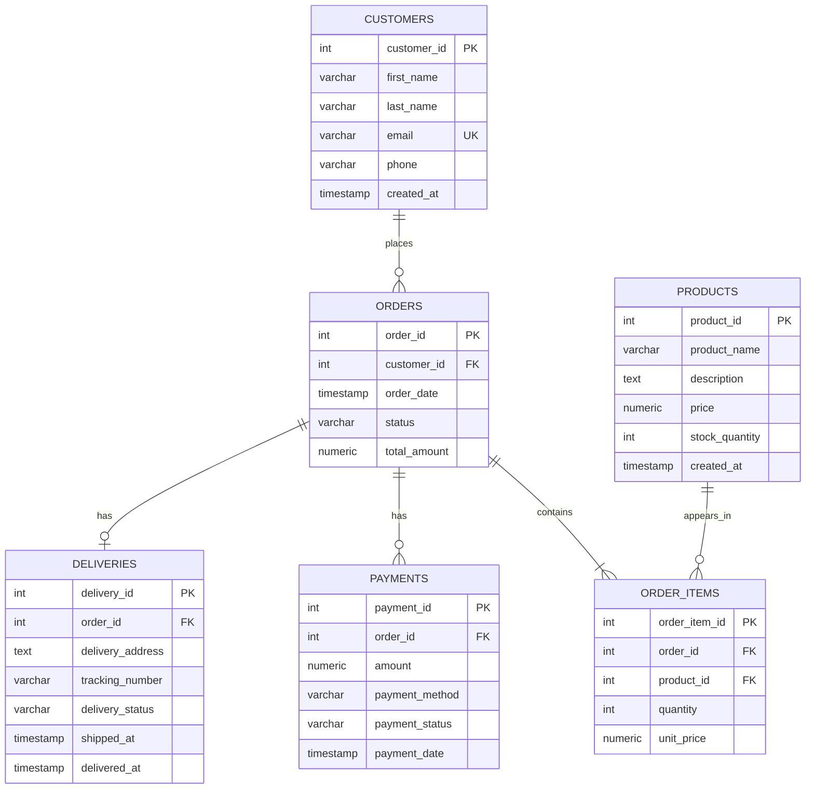

# Fabbyent Entity-Relationship Diagram (ERD)

## Overview

The Fabbyent E-commerce Order Management System uses six relational tables to manage customers, products, orders, order items, payments, and deliveries.

## ER Diagram

## Relationship Explanation

- **Customers and Orders:** One customer can place many orders. Each order belongs to one customer.
- **Orders and Order Items:** An order contains one or more order items. Each order item belongs to one order.
- **Products and Order Items:** A product can appear in many order items. Each order item references one product.
- **Orders and Payments:** An order can have multiple payment records. Each payment belongs to one order.
- **Orders and Deliveries:** An order can have zero or one delivery record. Each delivery belongs to one order.

## Key Constraints

- Primary keys uniquely identify records in each table.
- Foreign keys maintain relationships between related tables.
- Customer email addresses and delivery tracking numbers must be unique.
- Product prices, stock quantities, order totals, payment amounts, and order-item quantities are constrained to valid values.
- Order and payment statuses are restricted to the allowed values defined in `schema.sql`.
